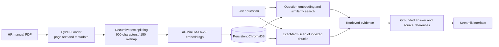
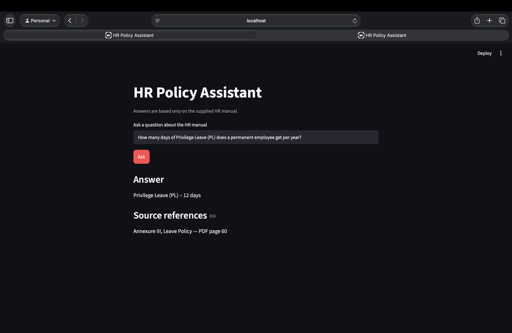
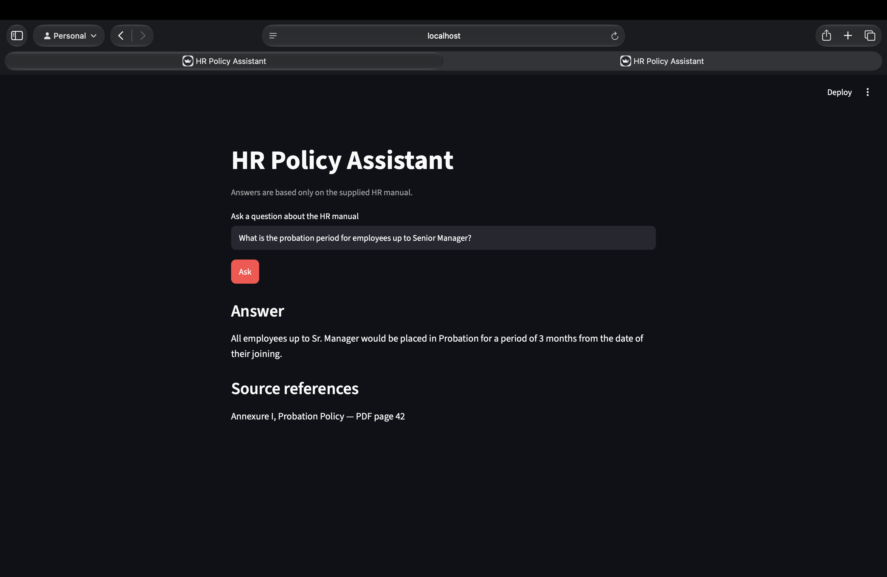
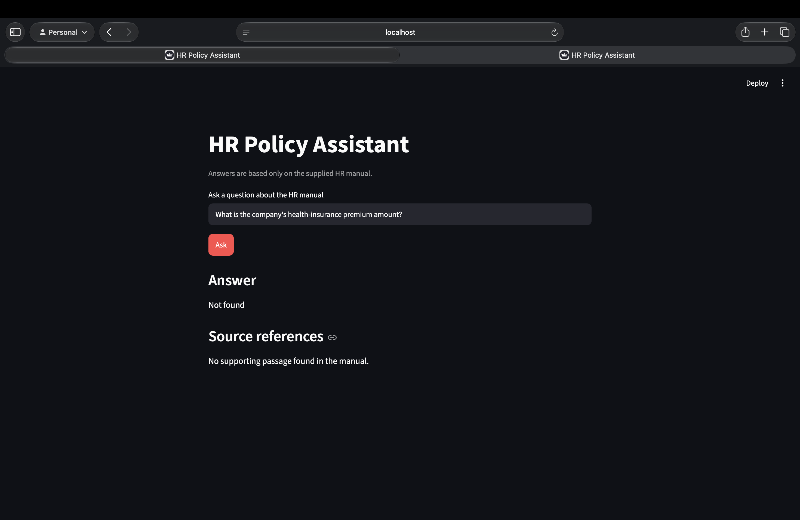
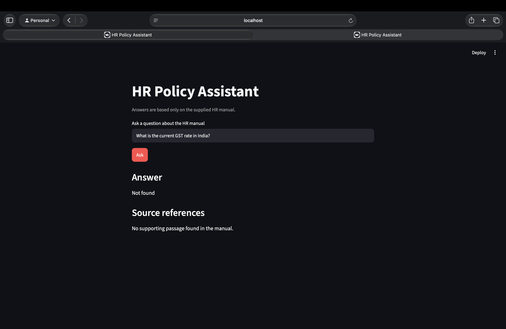
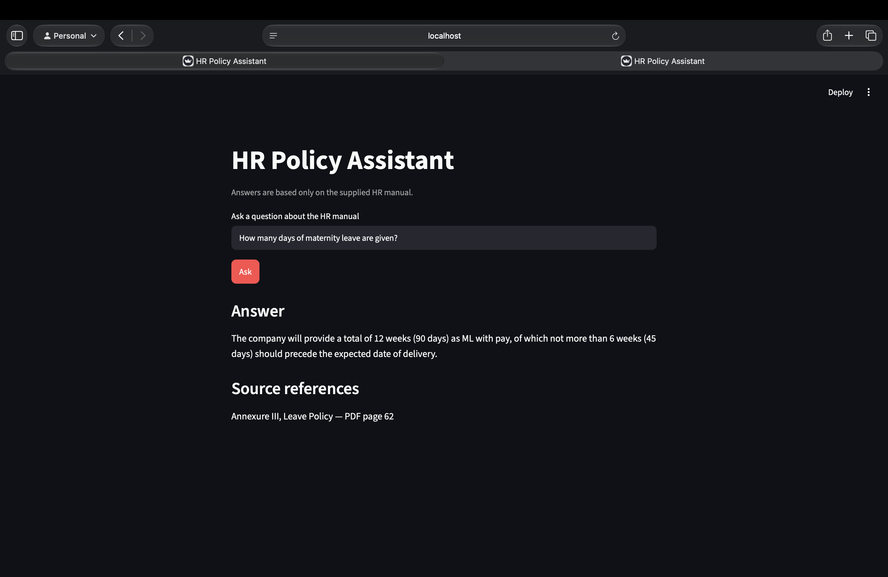

# HR Policy Assistant

A local question-answering application for Enso Group's HR manual. **Repository:** [JagguDada01/HR-policy-assistant](https://github.com/JagguDada01/HR-policy-assistant). It retrieves relevant passages from the supplied PDF, answers from those passages only, and shows the policy, annexure, and PDF page used as the source. Unsupported questions return **Not found**.

## Objectives

- Make HR policy information easy to find with natural-language questions.
- Keep answers grounded in the supplied manual instead of outside knowledge.
- Preserve page and policy metadata so answers can be checked against the source.
- Store document embeddings persistently so an unchanged manual is not re-embedded on every run.

## Technology stack

| Component | Technology | Use |
| --- | --- | --- |
| Language | Python 3.10+ | Application and document processing |
| PDF loading | LangChain `PyPDFLoader` | Load the manual page by page |
| Chunking | LangChain `RecursiveCharacterTextSplitter` | Split pages into 900-character chunks with 150-character overlap |
| Embeddings | Sentence Transformers `all-MiniLM-L6-v2` via `HuggingFaceEmbeddings` | Create local semantic vectors |
| Vector database | ChromaDB with LangChain Chroma integration | Persistent vector storage and similarity search |
| User interface | Streamlit | Local web interface for questions and sourced answers |

## RAG workflow



The loader keeps the physical PDF page number, the current annexure, and the policy heading in chunk metadata. Retrieval combines vector similarity with an exact-term scan to catch policy names and abbreviations. The answer step selects evidence from retrieved PDF chunks; it does not use an external language model or outside knowledge. If a topic is present but the manual does not give a definite amount, the app states that uncertainty.

## Project structure

```text
HR-policy-assis/
├── app.py                         # Streamlit interface
├── requirements.txt               # Python dependencies
├── README.md                      # Project and run instructions
├── .gitignore                     # Excludes secrets and generated files
├── data/
│   ├── source/
│   │   └── hr_manual.pdf          # Source HR manual
│   └── chroma/                    # Generated persistent index (ignored by Git)
├── screenshots/                   # Captures of actual app results
└── src/
    └── hr_policy/
        ├── config.py              # Paths, chunk settings, and model name
        ├── ingest.py              # PDF loading, splitting, embedding, indexing
        └── qa.py                  # Retrieval, answer generation, citations
```

## Installation and setup

Use Python 3.10 or newer. From the project folder, create and activate a virtual environment, then install the dependencies:

```bash
python3 -m venv .venv
source .venv/bin/activate        # macOS/Linux
# Windows PowerShell: .venv\Scripts\Activate.ps1
python -m pip install --upgrade pip
pip install -r requirements.txt
```

The first index build downloads the `sentence-transformers/all-MiniLM-L6-v2` model from Hugging Face and caches it locally. Internet access is needed for this first download. The manual is already included at `data/source/hr_manual.pdf`.

## Build the index and run the app

Build the persistent ChromaDB index:

```bash
python -m src.hr_policy.ingest
```

The current manual produced 254 chunks. The index manifest stores the PDF's SHA-256 fingerprint. Running ingestion again reuses the existing index if the PDF is unchanged; replacing the manual causes it to be rebuilt.

Start Streamlit in the project folder:

```bash
streamlit run app.py
```

Open the local URL printed by Streamlit, usually <http://localhost:8501>. Enter a question and select **Ask**.

## Test questions and observed answers

These results were checked against the manual and captured from the running Streamlit app.

| Test question | Answer | Source reference |
| --- | --- | --- |
| How many days of Privilege Leave (PL) does a permanent employee get per year? | 12 days | Annexure III, Leave Policy, PDF page 60 |
| What is the probation period for employees up to Senior Manager? | 3 months from the date of joining | Annexure I, Probation Policy, PDF page 42 |
| What is the company's health-insurance premium amount? | Not found | No supporting passage in the manual |
| What is the current GST rate in India? | Not found | No supporting passage in the manual |
| How many days of maternity leave are given? | The manual states a total of 12 weeks (90 days) of maternity leave with pay. Up to 6 weeks (45 days) may precede the expected date of delivery. | Annexure III, Leave Policy, PDF page 62 |

> **Maternity leave note:** The summary on PDF page 60 labels this “Maternity Leave (leeway)” without a day count. The detailed maternity leave table on PDF page 62 specifies 12 weeks (90 days), so the answer above follows that detailed provision.

## Application screenshots

The screenshots below show the entered question and the result rendered by the local application.

<details>
<summary>Question 1 — Privilege Leave</summary>



</details>

<details>
<summary>Question 2 — Probation period</summary>



</details>

<details>
<summary>Question 3 — Health-insurance premium</summary>



</details>

<details>
<summary>Question 4 — GST rate</summary>



</details>

<details>
<summary>Question 5 — Maternity leave</summary>



</details>
